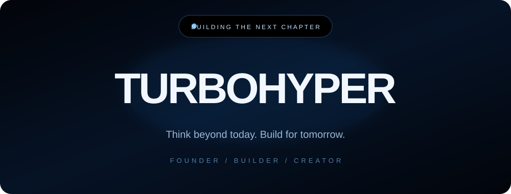
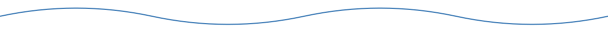
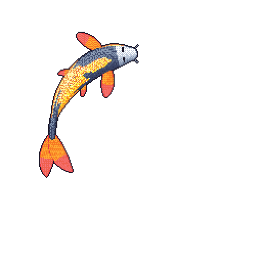
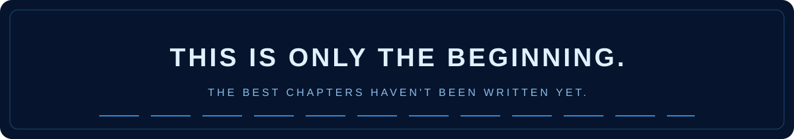

 

 

### `01 / THE PERSON BEHIND THE PIXELS`

I'm **Turbo** — an entrepreneur, founder, and curious builder fascinated by what technology can make possible.

I build with intention: thoughtful products, meaningful experiences, and ideas designed to grow beyond their first version. I'm not interested in simply launching something. I'm interested in seeing how far a good idea can go.

### `02 / THE THINGS I'M BUILDING`

<table>
<tr>
<td width="50%" valign="top">

#### ARVIA
**The company. The bigger vision.**

Arvia is where my long-term ambition takes shape — building meaningful digital experiences with curiosity, ownership, and purpose.

`VISION` · `PRODUCTS` · `INNOVATION`

</td>
<td width="50%" valign="top">

#### MELODIA
**Music deserves a beautiful experience.**

A music-streaming platform in development under Arvia, focused on discovery, listening, and a thoughtfully designed music experience.

[**Explore Melodia ↗**](https://itsmelodia.com)

</td>
</tr>
</table>

### `03 / A LITTLE LIFE IN THE CODE`

**THE GIT KOI · A LIVING REFLECTION OF MY GITHUB ACTIVITY**

Its colors, growth and movement evolve with public activity. Powered by <a href="https://github.com/yalongwastaken/git-koi">git-koi</a>. Updated daily by GitHub Actions.

### `04 / THE SIGNAL`

### `05 / THE PRINCIPLES`

**Think long-term.** Build beyond the next milestone.  
**Create with purpose.** Experiences should mean something.  
**Stay curious.** There is always more to learn.  
**Take ownership.** Care about the details.  
**Keep moving.** Consistency compounds.

### `06 / BEYOND THE SCREEN`

Music and new sounds · Anime and entertainment · Football and goalkeeping · Fitness · Technology and new ideas

Designed in midnight blue. Built for what's next.

